<p align="center">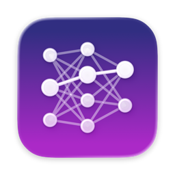</p>

<h1 align="center">Synapse</h1>

<p align="center"><b>Every kind of AI model, running on your Mac, behind the APIs your tools already speak.</b></p>

<p align="center">
  <a href="https://github.com/KyleBoyer/synapse/releases/latest"></a>
  <a href="https://github.com/KyleBoyer/synapse/actions/workflows/ci.yml"></a>
  
  
  <a href="LICENSE"></a>
</p>

<p align="center">
  <a href="https://github.com/KyleBoyer/synapse/releases/latest"><b>Download</b></a> ·
  <a href="#quick-start">Quick start</a> ·
  <a href="#use-it-from-code">Use it from code</a> ·
  <a href="#what-it-runs">What it runs</a> ·
  <a href="#reference">API reference</a>
</p>

<p align="center">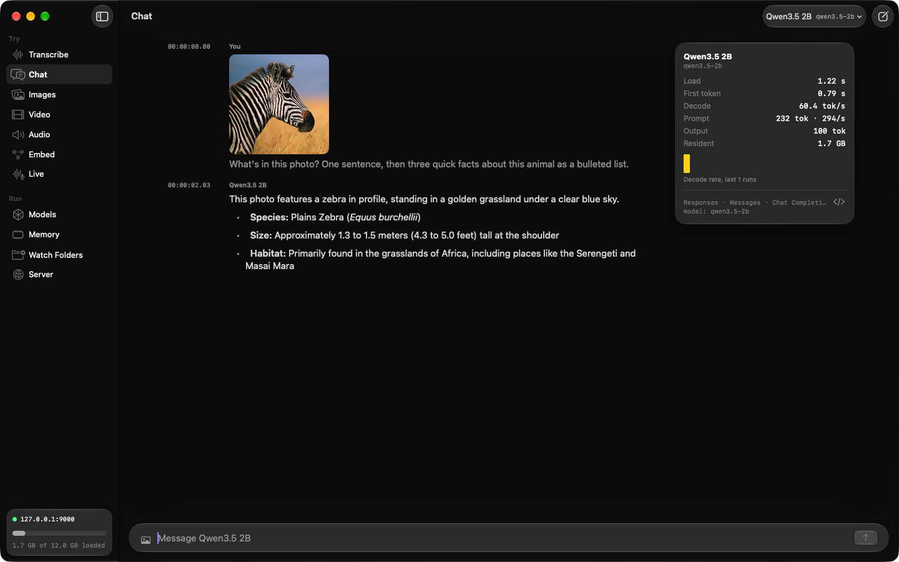</p>

Synapse is a native macOS app and a local server in one. It chats, sees, listens, transcribes, speaks, clones voices, makes music, draws, upscales, cuts out, edits video, embeds and reranks, and holds live voice calls. Every model runs on your Mac's GPU and Neural Engine. Nothing leaves the machine.

The same models answer on `http://127.0.0.1:9000` in the shapes of the **OpenAI**, **Anthropic** and **LM Studio** APIs, so the official SDKs, chat apps, coding agents and media tools (Bazarr included) work with it unchanged.

## Highlights

- **Private by default.** No account, no cloud, no telemetry. Audio, images and video stay on your disk.
- **A drop-in API.** OpenAI Chat Completions, Responses, Audio, Images, Embeddings, Videos and Realtime; Anthropic Messages; LM Studio's REST API; Cohere and Jina rerank; Bazarr's Whisper provider. Streaming, tool calls and vision included.
- **Every modality in one place.** Text, images, video and audio in. Text, speech, music, images and video out. Full-duplex voice models that listen while they talk.
- **A real Mac app, not a web wrapper.** SwiftUI and Liquid Glass, with a live readout on every pane: time to first token, tokens per second, memory, and the exact API call that does the same thing.
- **Any model from Hugging Face.** Paste a repo name. Synapse checks it, tells you how it would run it, and then runs it in-process on MLX, through mlx-vlm, or as a GGUF on a bundled llama.cpp.
- **Fast follow-up turns.** A prompt cache reuses the conversation so far, so turn two of a long chat or agent session starts in a tenth of the time. Long prompts are saved to disk and stay warm across restarts.
- **Built for a laptop's memory.** A memory budget, one GPU user at a time, idle unloading, and optional vOOM paging for models larger than RAM. Every screenshot here was taken on a 16 GB M4 Mac mini.

## See it work

Every screenshot below is a real run on the 16 GB Mac mini.

<table>
  <tr>
    <td width="50%">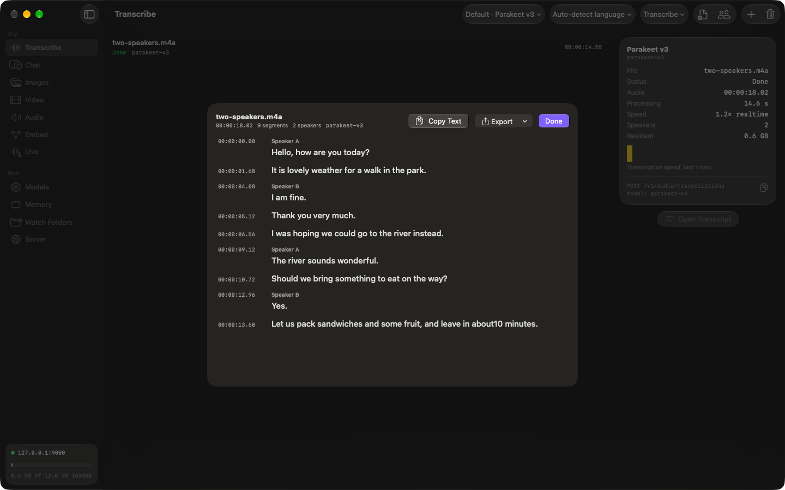<br><b>Transcribe, with speakers.</b> Whisper or Parakeet on the Neural Engine, speaker labels from a diarization model, and SRT, WebVTT or JSON out. Watch a folder and subtitles appear next to your media.</td>
    <td width="50%">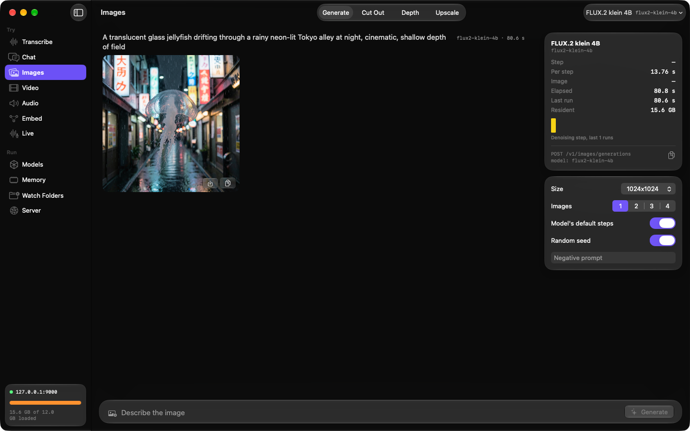<br><b>Generate images.</b> FLUX.2 klein, Z-Image and Qwen-Image, with seed, size and steps, and the OpenAI Images API on top. This 1024 × 1024 jellyfish took 81 seconds.</td>
  </tr>
  <tr>
    <td>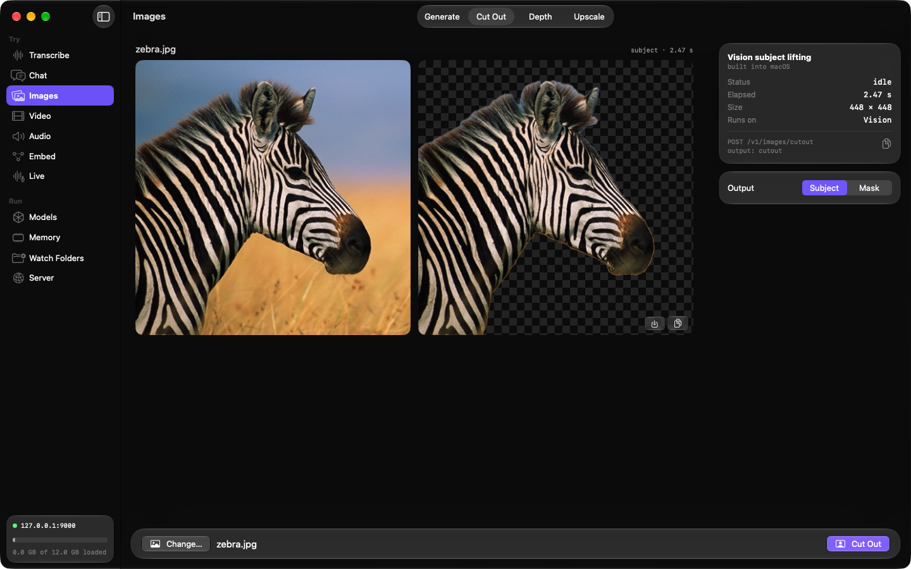<br><b>Cut out, depth, upscale.</b> Lift a subject with macOS Vision, make a depth map with Depth Anything V2, or upscale ×4 with Real-ESRGAN.</td>
    <td>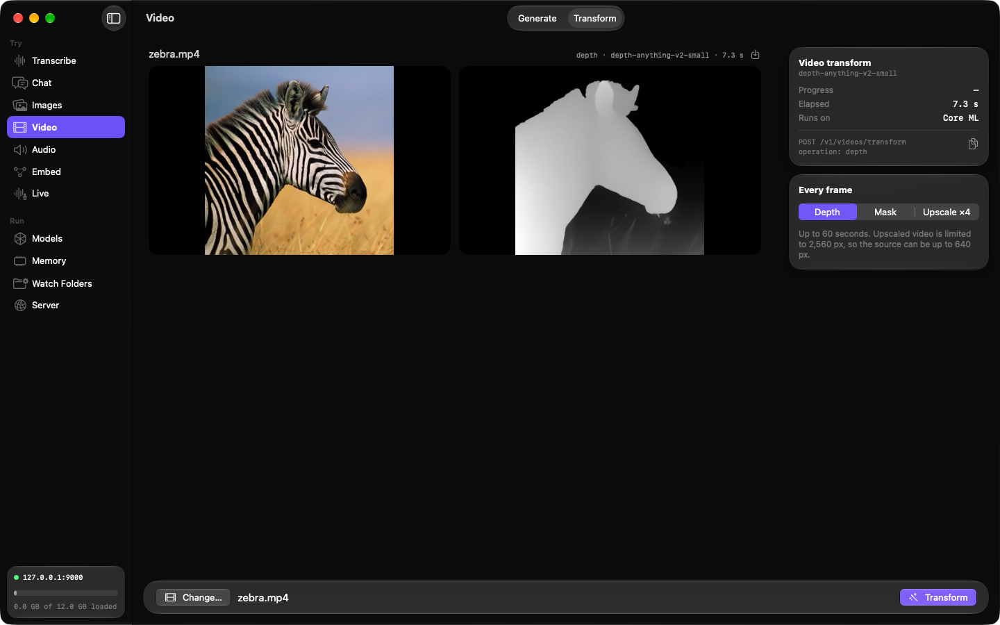<br><b>Transform video.</b> Run every frame through depth, subject mask or ×4 upscaling, keeping the sound and timing. Generate new clips with LTX-2.3.</td>
  </tr>
  <tr>
    <td>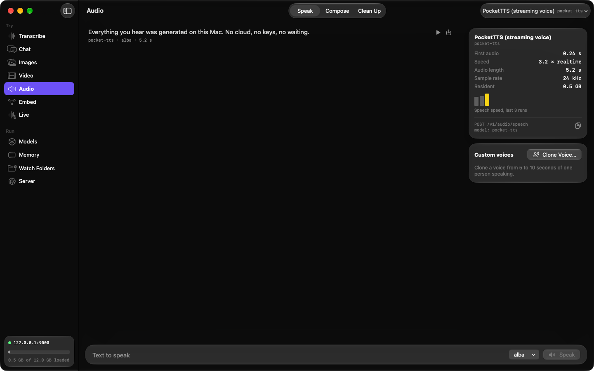<br><b>Speak and clone voices.</b> Five speech engines; PocketTTS starts talking in a quarter second and runs 3× faster than realtime. Clone a voice from a 10-second clip and use it everywhere, including voice calls.</td>
    <td>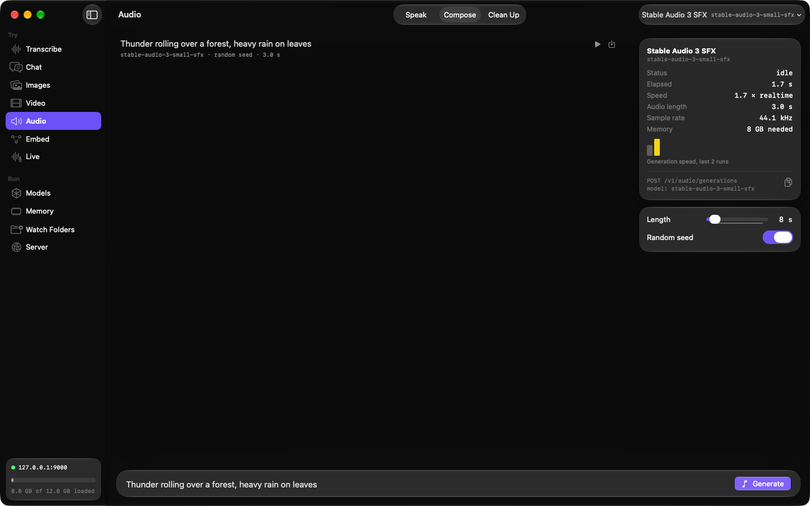<br><b>Make music and sound effects.</b> Stable Audio 3 from a text prompt. Clean Up removes noise, splits speakers, pulls out a described sound, or re-voices a recording.</td>
  </tr>
  <tr>
    <td>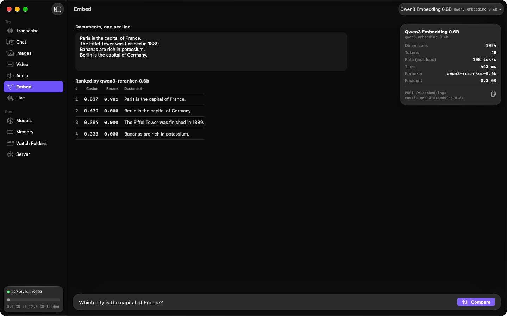<br><b>Embed and rerank.</b> Text and image embeddings plus a reranker, for search and RAG, behind the OpenAI and Cohere shapes.</td>
    <td>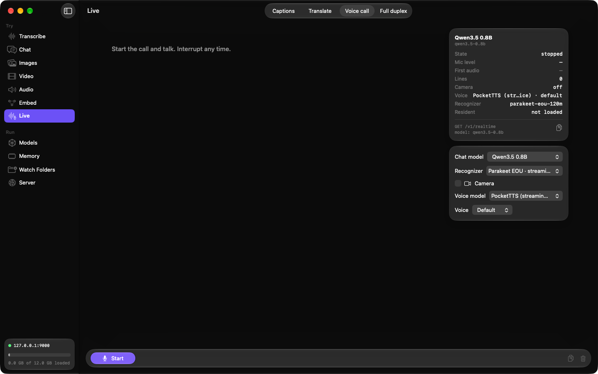<br><b>Talk to it.</b> Live captions, translation and voice calls (with the camera, if you like) over the OpenAI Realtime protocol. Pick how it hears, thinks and speaks.</td>
  </tr>
  <tr>
    <td>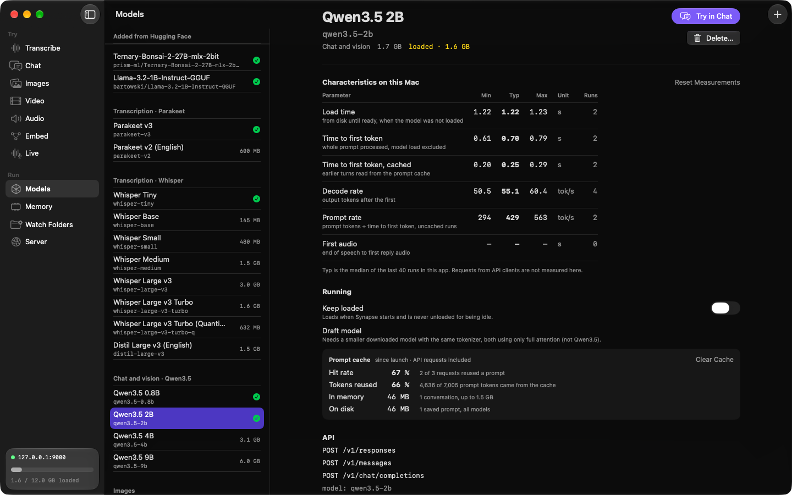<br><b>Know what you're running.</b> Every model shows what it costs on <i>your</i> Mac: load time, first token with and without the prompt cache, decode rate, memory, and how much of every request the cache answered.</td>
    <td>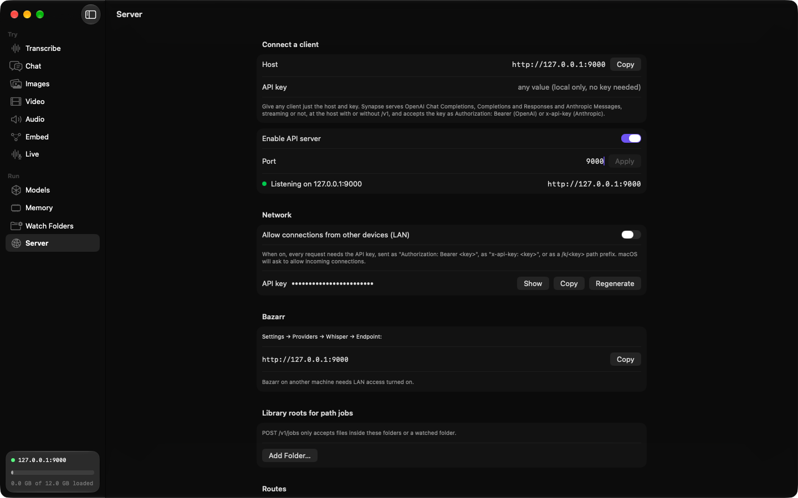<br><b>Serve your network.</b> One switch opens the server to your LAN behind an API key, with a ready-to-paste URL for each client.</td>
  </tr>
  <tr>
    <td>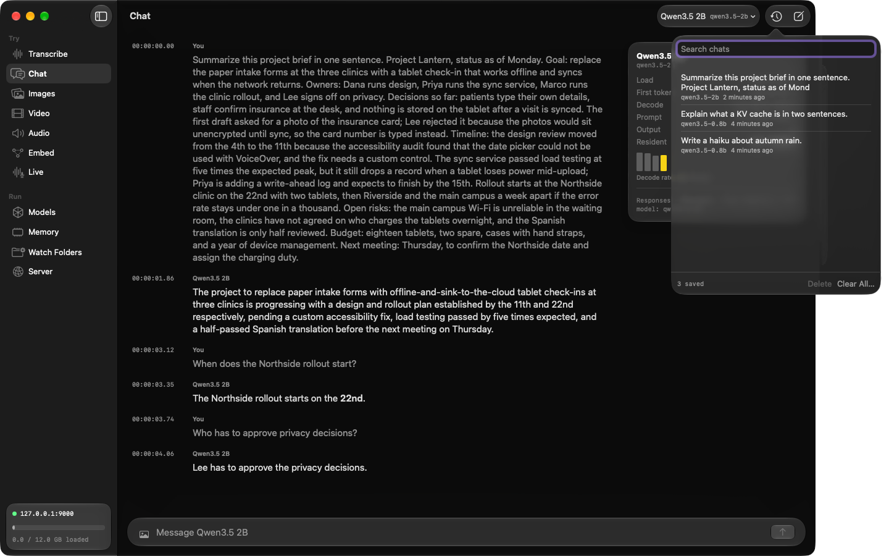<br><b>Pick up where you left off.</b> Chats, images, clips, calls and transcripts are kept across launches, ready to reopen or delete. Here the follow-ups read 428 of 464 prompt tokens from the cache.</td>
    <td>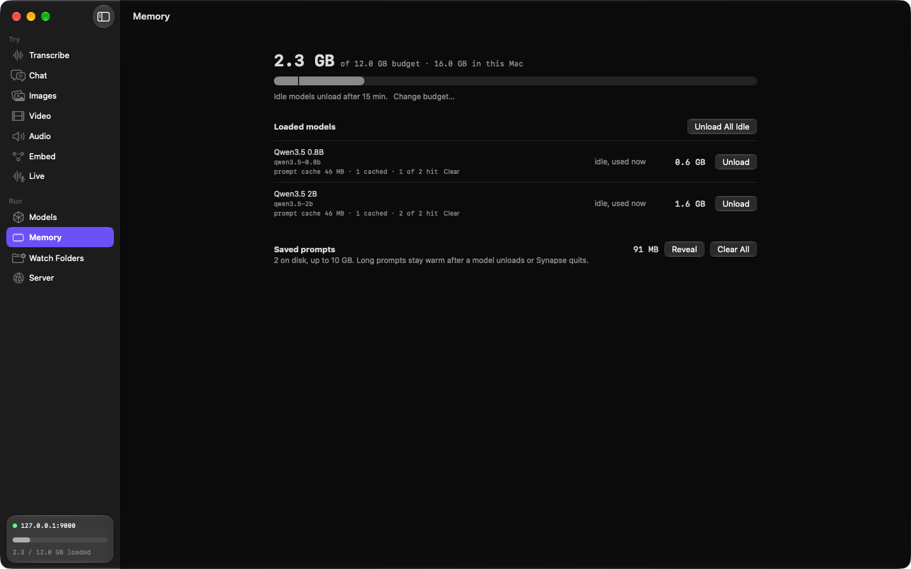<br><b>See where the memory goes.</b> Measured memory for every loaded model, its prompt cache, and the long prompts saved to disk so they stay warm after a restart.</td>
  </tr>
</table>

## Quick start

1. Download `Synapse-<version>.dmg` from [the latest release](https://github.com/KyleBoyer/synapse/releases/latest), open it, and drag Synapse onto the Applications folder. Releases are signed with a Developer ID and notarized by Apple, and Synapse updates itself from then on (Sparkle; **Synapse ▸ Check for Updates…** checks now).
2. Open Synapse, go to **Models**, and download a model. `Qwen3.5 2B` (1.6 GB) is a good first chat model; `Parakeet v3` is a good first transcriber.
3. Press **Try in Chat**, or point any OpenAI or Anthropic client at `http://127.0.0.1:9000`.

Closing the window doesn't quit Synapse. It keeps serving and watching folders from the menu bar (the waveform icon), with no Dock icon until you choose **Open Synapse** there. **Quit Synapse** in that menu stops it.

You need an Apple Silicon Mac with macOS 26 or later. 16 GB of memory runs everything in the gallery; the largest models (full-precision LTX-2.3, Qwen3-Omni 30B, MiniCPM-o) want 32 to 64 GB or more.

## Use it from code

Use the official SDKs and give them Synapse's address. Without LAN access, any API key works.

```python
from openai import OpenAI

c = OpenAI(base_url="http://localhost:9000/v1", api_key="x")

print(c.chat.completions.create(model="qwen3.5-2b", messages=[{"role": "user", "content": "Write a haiku about RAM."}]).choices[0].message.content)
print(c.audio.transcriptions.create(model="whisper-1", file=open("interview.m4a", "rb"), response_format="srt"))
c.audio.speech.create(model="tts-1", voice="alloy", input="Hello from Synapse.").write_to_file("hello.mp3")
c.images.generate(model="flux2-klein-4b", prompt="a lighthouse made of glass", size="1024x1024")
v = c.embeddings.create(model="text-embedding-3-small", input=["Paris is the capital of France."]).data[0].embedding
```

```python
import anthropic

c = anthropic.Anthropic(base_url="http://localhost:9000", api_key="x")  # the SDK adds /v1
print(c.messages.create(model="qwen3.5-2b", max_tokens=256, messages=[{"role": "user", "content": "Hi"}]).content[0].text)
```

```bash
curl -s localhost:9000/v1/audio/generations -H 'Content-Type: application/json' \
  -d '{"prompt":"rain on a tin roof","seconds":5}' -o rain.wav
```

It also works with anything that lets you set an OpenAI or Anthropic base URL: chat front ends, coding agents, LangChain and LlamaIndex, n8n, and LM Studio clients. Bazarr uses it as a Whisper provider ([setup](#bazarr-setup)).

## What it runs

| You want to | In the app | API | Models |
|---|---|---|---|
| Chat, with images, video and audio | Chat | `/v1/chat/completions`, `/v1/responses`, `/v1/messages`, `/api/v1/chat` | Qwen3.5 (0.8B to 9B), Inkling 2 Mini, Gemma 3n and 4, LFM3 Omni, MiniCPM-o 4.5, Qwen3-Omni 30B, and any MLX or GGUF chat model from Hugging Face |
| Transcribe and subtitle | Transcribe, Watch Folders | `/v1/audio/transcriptions`, `/v1/audio/translations`, `/asr` | Whisper (Tiny to Large v3 Turbo), Distil Large v3, Parakeet v2 and v3, speaker diarization |
| Talk in real time | Live | `/v1/realtime` | Parakeet EOU and Silero VAD to hear, any chat model to think, any voice to speak; full-duplex PersonaPlex 7B and Nemotron VoiceChat 11B; Hibiki Zero for French-to-English speech translation |
| Speak text, clone voices | Audio → Speech | `/v1/audio/speech`, `/v1/audio/voices` | PocketTTS, Kokoro 82M, Qwen3-TTS 1.7B, VoxCPM2, Chatterbox Turbo |
| Make music and sound | Audio → Sound & Music | `/v1/audio/generations` | Stable Audio 3 SFX, Music and Medium; ACE-Step 1.5 (instrumental music); MiniMax Music 3 (songs with sung lyrics) |
| Clean up audio | Audio → Clean Up | `/v1/audio/enhance`, `/v1/audio/separate`, `/v1/audio/convert` | DeepFilterNet 3, NemotronLabs RE-USE, SAM-Audio, DialogueSidon, Chatterbox |
| Generate and edit images | Images → Generate | `/v1/images/generations`, `/v1/images/edits` | FLUX.2 klein 4B and 9B, Z-Image and Z-Image Turbo, Qwen-Image 2.1 and 2512, Qwen-Image Edit |
| Cut out, depth, upscale | Images | `/v1/images/cutout`, `/v1/images/depth`, `/v1/images/upscale` | macOS Vision, Depth Anything V2, Real-ESRGAN |
| Generate video | Video → Generate | `/v1/videos` | LTX-2.3 Distilled; Wan 2.2 TI2V 5B; MiniMax H3 (with sound), plus its Turbo LoRA and LoRAs you add from Hugging Face |
| Transform video | Video → Transform | `/v1/videos/transform` | the image tools above, per frame |
| Search and RAG | Embed | `/v1/embeddings`, `/v1/rerank` | Qwen3 Embedding, EmbeddingGemma, Qwen3-VL Embedding, SigLIP2, Qwen3 Reranker |

Some models carry their own licenses (non-commercial, Gemma terms, research use). The Models pane names the license in the model's title, and `THIRD_PARTY_NOTICES.md` lists them.

## Reference

Everything below is detail. Open what you need.

<details>
<summary><b>Install notes: LAN access and the firewall</b></summary>

If you turn on **Allow LAN** in the Server pane, the server binds to `0.0.0.0` and macOS asks whether to allow incoming connections. With ad-hoc signed builds (built from source, or a release without the signing secrets) that prompt can come back after each update. An ad-hoc build is also blocked by Gatekeeper on first launch: run `xattr -dr com.apple.quarantine /Applications/Synapse.app`, or right-click the app and choose Open.

</details>

<details>
<summary><b>Connecting a client: addresses, keys and errors</b></summary>

Default address is `http://127.0.0.1:9000`. The port and LAN access are set in the Server tab. With LAN off, no key is needed. With LAN on, every route except `/health` needs the API key, sent as `Authorization: Bearer <key>`, as `x-api-key: <key>`, or as a path prefix `/k/<key>/...`. Errors use `{"type":"error","error":{"message":"...","type":"invalid_request_error"}}`, which both OpenAI and Anthropic clients read.

Give a client only the host (for example `http://192.168.1.20:9000`) and the API key. Every API route answers with and without the `/v1` prefix (and at `/v1/v1`, for a `host/v1` base URL pasted into a client that adds `/v1` itself), so OpenAI SDKs work with `base_url` set to the host or `host/v1`, and the Anthropic SDK works with the host. The key is accepted as `Authorization: Bearer <key>` (OpenAI clients), `x-api-key: <key>` (Anthropic clients), or a `/k/<key>` path prefix. Each protocol answers in its own shape, streaming (SSE) or not. `scripts/verify-connect.py <host> <key>` checks all of this with the official SDKs.

</details>

<details>
<summary><b>Models, transcription and jobs API</b></summary>

| Method and path | Input | Output |
|---|---|---|
| `GET /health` | none | `{"status":"ok","version":"0.1.0"}` |
| `GET /v1/models` | Anthropic paging: `limit` (1–1000), `after_id`, `before_id`; without `limit`, every model | downloaded models. Each object has OpenAI's fields (`object`, `created`, `owned_by`) and Anthropic's (`type`, `display_name`, `created_at`; for chat models `capabilities`, `max_input_tokens`, `max_tokens`), plus `synapse`: kind, engine, size, whether it is loaded, architecture, context length, quantization, input and output modalities, and the endpoints that serve it. `created` is the download date. |
| `GET /v1/models/{id}` | none | one model, same object; ids with a slash (`org/name`, plain or `%2F`) work. 404 when not downloaded. |
| `GET /api/v1/models` | none | LM Studio's list: chat (`llm`) and embedding models with publisher, format (`mlx` or `gguf`), quantization, size, `loaded_instances`, `max_context_length` and capabilities (vision, tool use, reasoning). |
| `POST /v1/audio/transcriptions` | multipart: `file`, `model`, `language`, `response_format` (default `json`; also `diarized_json`), `diarize` (`true` labels speakers); `prompt`, `temperature`, `timestamp_granularities[]` are ignored. `whisper-1`, `gpt-4o-transcribe`, `gpt-4o-mini-transcribe` mean the default model; `gpt-4o-transcribe-diarize` also labels speakers | transcript in the requested format; with speakers, SRT lines start with `A: `, WebVTT uses `<v Speaker A>` |
| `POST /v1/audio/translations` | same, translates to English | same |
| `POST /asr` | query: `task`, `language`, `output` (txt, vtt, srt, tsv, json; default `txt`), `encode` (default `true`); multipart: `audio_file`. `word_timestamps`, `vad_filter`, `initial_prompt`, `video_file` are ignored | rendered format as `text/plain` with `Content-Disposition` and `Asr-Engine: synapse` |
| `POST /detect-language` | query: `encode`; multipart: `audio_file` | `{"detected_language":"english","language_code":"en","confidence":0.97}`; `und` if no multilingual Whisper model is downloaded |
| `POST /v1/jobs` | JSON `{"path","model"?,"language"?,"task"?,"force"?,"diarize"?}` | `202 {"id","status":"queued"}`; 403 if the path is outside the library roots or watched folders; 404 if missing |
| `GET /v1/jobs` | none | `{"data":[job...]}` |
| `GET /v1/jobs/:id` | none | `{"id","status","progress","source","output","model","error","created_at"}` |
| `DELETE /v1/jobs/:id` | none | 200 after cancelling |

Job status values: `queued`, `preparing_model`, `decoding`, `transcribing`, `done`, `failed`, `cancelled`, `skipped`. Synchronous routes wait behind other queued jobs. `model=whisper-1` is accepted and maps to the default model. `encode=false` means the upload is raw 16-bit little-endian PCM.

```bash
FIX=Packages/SynapseCore/Tests/SynapseCoreTests/Fixtures
curl -s localhost:9000/health
curl -s localhost:9000/v1/models
curl -s localhost:9000/v1/audio/transcriptions -F file=@$FIX/en.mkv -F response_format=srt
curl -s "localhost:9000/asr?task=transcribe&language=en&output=srt&encode=false" -F audio_file=@$FIX/en.pcm
curl -s -X POST "localhost:9000/detect-language?encode=false" -F audio_file=@$FIX/en.pcm
```

</details>

<details>
<summary><b>Chat and vision: Chat Completions, Responses, Messages, LM Studio</b></summary>

| Route | Notes |
|---|---|
| `POST /v1/chat/completions` | `messages` with string content or parts (`text`, `image_url` with a `data:` or `http(s)` URL, `video_url` with an MP4/MOV `data:` or `http(s)` URL, `input_audio` with base64 `data` and a `format` for omni models); `modalities: ["text", "audio"]` with `audio: {"format", "voice"}` for a spoken reply in `message.audio` (`wav`, `mp3`, `flac`, `opus`, `aac`, `pcm16`; streaming needs `pcm16` and sends `delta.audio`); `max_tokens`/`max_completion_tokens`, `temperature`, `top_p`, `stop`, `stream`, `stream_options.include_usage`. Function `tools` (and `tool_choice`, `"none"` to turn them off): calls come back as `message.tool_calls` (finish_reason `tool_calls`; streamed as `delta.tool_calls`), and `tool` role messages carry results back. |
| `POST /v1/completions` | OpenAI legacy completions: one `prompt` string continued as raw text (no chat template); `max_tokens` (default 256), `temperature`, `top_p`, `stop`, `echo`, `stream`, `stream_options.include_usage`. |
| `POST /v1/responses` | `input` as a string or message items with `input_text` / `input_image` / `input_video` / `input_audio` parts; `instructions`, `max_output_tokens`, `temperature`, `top_p`, `stream` (typed SSE events through `response.completed`). Function `tools` (`{"type":"function","name",...}`): calls come back as `function_call` output items (streamed with `response.function_call_arguments.delta/done`), and `function_call_output` input items carry results back. |
| `POST /v1/messages` | Anthropic Messages: `system`, `messages` with `text`, `image` (base64 or url), `tool_use` and `tool_result` blocks; `max_tokens`, `temperature`, `top_p`, `stop_sequences`, `tools`, `tool_choice`, `thinking`, `stream` (named SSE events `message_start` through `message_stop`). `claude-*` model ids map to the default chat model. |
| `POST /v1/messages/count_tokens` | same body as `/v1/messages` | `{"input_tokens": n}` |
| `POST /api/v1/chat` | LM Studio's native chat API: `model`, `input` (a string, or `text` and `image` items), `system_prompt`, `previous_response_id` (Synapse keeps the last 256 conversations in memory), `store`, `reasoning` (`"off"` or on), `max_output_tokens`, `temperature`, `top_p`, `stream`. The stream is LM Studio's named events: `chat.start`, `model_load.start`/`.end` (only when the model was not loaded), `prompt_processing.start`/`.progress`/`.end`, `reasoning.*`, `message.*`, `chat.end` with the full result and `stats`. Prompt progress fractions come from GGUF models (llama.cpp); MLX and mlx-vlm models report start and end. No load fractions: no engine reports one. `integrations` (MCP, plugins) are refused. |

`model` is a catalog id such as `qwen3.5-0.8b`; omit it to use the smallest downloaded chat model. Qwen3.5 thinking mode is off unless `reasoning_effort` (Chat Completions) or `reasoning.effort` (Responses) is set to something other than `none` or `minimal`, or `thinking.type` (Messages) is `enabled` or `adaptive`; Messages returns the reasoning as a `thinking` block. Messages `tool_choice` of `any` or a named tool is treated as `auto`. Images are capped at about one megapixel before they reach the model. One chat model stays loaded at a time.

```python
import base64
img = "data:image/jpeg;base64," + base64.b64encode(open("zebra.jpg", "rb").read()).decode()
r = c.responses.create(model="qwen3.5-0.8b", input=[{"role": "user", "content": [
    {"type": "input_text", "text": "What animal is this?"},
    {"type": "input_image", "image_url": img}]}])
print(r.output_text)
```

**Video in chat.** Qwen3.5 models and the omni models (except Gemma 3n) read video. Send a `video_url` part (Chat Completions) or `input_video` part (Responses) holding an MP4 or MOV as a `data:` URL or an `http(s)` URL, up to 200 MB. Synapse samples 8 frames. File paths and `file://` URLs are refused. A model without video input returns 400.

**Tool calls** work on Chat Completions, Responses, Anthropic Messages and realtime, for every input and output type: text, images, video and audio in (audio through the mlx-vlm models), spoken replies (a call comes back as `tool_calls` with `audio: null`), voice calls with or without the camera, and every chat engine (in-process MLX, mlx-vlm and GGUF through their servers' own tool parsers). Small models call less readily: Qwen3.5 0.8B only without a system prompt; 2B and larger decide on their own.

</details>

<details>
<summary><b>Running models: prompt cache, KV precision, speculative decoding, sampling, thinking budget, keep warm</b></summary>

**Prompt cache.** Caching is automatic; there is nothing to send. Each chat model keeps the attention state of recent conversations, so a request that starts with an earlier conversation only reads its new part:
- **In-process MLX models.** Synapse saves the state where the history ends and the generation prompt begins. Every follow-up turn starts with exactly those tokens, so reuse works even on Qwen3.5, whose recurrent layers cannot be rewound.
- **llama.cpp and mlx-vlm.** These use their own prefix caches. Synapse turns mlx-vlm's on only on Macs with 32 GB or more, because it refuses requests outright when free memory runs short.
- **Disk.** Histories of 1,024 tokens or more are also saved to `<models>/cache` and survive unloads and restarts.
- **Not cached.** Requests that carry images, video or audio.

Measured on Qwen3.5 0.8B with a 2,300-token system prompt: time to first token on turn 2 went from 1.07 s to 0.11 s, with identical output.

Reuse is reported in each API's usage fields:

| API | Field |
|---|---|
| Chat Completions, Completions | `usage.prompt_tokens_details.cached_tokens` |
| Responses | `usage.input_tokens_details.cached_tokens` |
| Anthropic Messages | `usage.cache_read_input_tokens` (`input_tokens` counts only the rest). `cache_control` is accepted and not needed. |
| LM Studio | `stats.cached_tokens` |

Settings → Running models sets the cache memory (1.5 GB per model by default on 16 GB Macs) and the disk limit (10 GB). Each model card shows hit rate, tokens reused, and memory and disk use, counting API requests too.

**KV cache precision.** Settings → Running models offers Full, 8-bit or 4-bit storage for attention keys and values. Longer contexts and more cached prompts fit in memory, at a small quality cost. It applies to MLX (affine quantization), llama.cpp (`q8_0`/`q4_0`) and mlx-vlm (`KV_BITS`). On hybrid models only the attention layers shrink: a Qwen3.5 0.8B checkpoint goes from 48 MB to 35 MB at 8-bit.

**Speculative decoding.** On a model card, Draft model picks a smaller model with the same tokenizer. The draft proposes tokens and the main model checks them in one pass, so output is unchanged. It needs models built only from full attention: Llama, Qwen3 and Mistral qualify; Qwen3.5 (linear attention) and models with sliding windows do not. Measured: Llama 3.2 3B drafted by Llama 3.2 1B decodes at 69 tok/s instead of 50.

**Sampling.** `seed`, `top_k`, `min_p`, `presence_penalty`, `frequency_penalty` and `repetition_penalty` (LM Studio's `repeat_penalty`) work on every chat route and engine; Anthropic Messages takes `top_k`. The same seed reproduces the same text.

**Thinking budget.** `reasoning_effort` and Responses' `reasoning.effort` map as follows: `none` and `minimal` turn thinking off; `low` caps it at 1,024 tokens; `medium` at 4,096; `high` leaves it unlimited. Anthropic's `thinking: {"type": "enabled", "budget_tokens": n}` sets the cap directly. When the cap is reached the model's own `</think>` is inserted. Small Qwen3.5 models often keep reasoning after a forced stop instead of answering cleanly, so a budget trades answer quality for time.

**Keep loaded.** A model card's Keep loaded switch loads that model when Synapse starts and never unloads it for being idle. It still gives way when another model needs the memory.

</details>

<details>
<summary><b>Saved history</b></summary>

Work done in the app is kept across launches: chats, images, clips, video, Live call transcripts (never audio), dropped transcriptions and Embed comparisons. Requests from API clients are never saved.

- **Chat, Live, Transcribe and Embed.** A History button lists earlier items; open one, delete one or a selection, or clear them all.
- **Images, Audio and Video.** Earlier items show in the pane, each with Delete, and the toolbar has Clear History.
- **Settings → History.** Keep history forever, 90, 30 or 7 days, or turn it off. Delete All removes everything.

Files live in `~/Library/Application Support/Synapse/History`.

</details>

<details>
<summary><b>Omni models: audio in, speech out</b></summary>

`inkling-2-mini` (Thinking Machines' Inkling 2 Mini, Apache-2.0) is a looped mixture-of-experts model: 26.2B parameters with 3.4B active, text and images in. It runs on the bundled llama.cpp from ggml-org's GGUFs, sized to the Mac. Macs with 48 GB or more get Q8_0 (27.8 GB). 32 GB Macs get IQ4_NL (17.6 GB). Smaller Macs download IQ4_NL with its imatrix and requantize it once to 11.6 GB: gate/up experts at IQ2_S and down experts at IQ4_NL, about 2 minutes. On a 16 GB M4 that runs entirely on the GPU at about 16 tokens/s, with a 4,096-token context. The published files don't fit there: IQ4_NL swaps (0.4 tokens/s), and Unsloth's smaller quants keep NVFP4 experts, which Metal can't multiply (about 5 tokens/s). It always writes a short reasoning note before answering. With thinking off, Synapse sends `reasoning_effort: "none"` to its template, which keeps the note short.

`gemma-3n-e2b` (audio and image), `gemma-4-e2b`, `lfm3-omni-2b`, `minicpm-o-4.5` and `qwen3-omni-30b` run in a managed mlx-vlm server and answer on every chat route. Send audio as an `input_audio` part; non-WAV audio is converted to 16 kHz WAV first. Small omni models follow the prompt closely: "Transcribe the audio." works better than "What does the speaker say?".

`lfm3-omni-2b` also speaks. Ask Chat Completions for audio with it, or pick it for a voice call (`/v1/realtime?model=lfm3-omni-2b` with audio output, or **Live → Voice call**) and it hears your turn and any camera frame itself, then answers in its own voice, streamed as it is generated; there is no separate speech synthesis. Barge-in stops it mid-sentence. On an M4 Mac mini the first audio arrives about 0.75 s after you stop talking once the model is loaded. Speech recognition still runs, only to show your words in the transcript.

</details>

<details>
<summary><b>Images: generate, edit, cut out, depth, upscale</b></summary>

To change a picture you made, press **Edit** (the wand) on it, then describe the change, for example "make it night". The image becomes the reference for an edit-capable model (FLUX.2 klein or Qwen-Image Edit, chosen for you if the current model can't edit), at the size closest to the original's. Press Edit on the new result to keep going. Saved images from earlier sessions can be edited the same way. Over the API this is `/v1/images/edits`.

Every result also has a **Send To** menu (the arrow), so each modality can feed every other. Where a model takes the input directly, it goes straight in; otherwise it goes through text: audio is transcribed and the transcript makes the image, an image is described in Chat and the reply makes the sound. Prompts land in the target's composer for you to edit and run; Synapse adds no words of its own.

| From | Send To |
|---|---|
| An image (or a Cut Out, Depth or Upscale result) | Edit in Images · Animate in Video · Ask About It in Chat |
| A video clip | Edit Frame in Images · Animate from Frame (the frame at the playhead) · Transform in Video · Clean Up Its Sound · Transcribe Its Speech · Ask About It in Chat |
| An audio clip | Clean Up · Transcribe · Ask About It in Chat (switches to an omni model) · and, for speech and sounds, Make an Image, Video or Sound from its text |
| A chat reply, transcript or call transcript | Make an Image · Make a Video · Speak It · Make a Sound · Ask About It in Chat |

Quick buttons cover the common steps: **Edit** and **Animate** on images, **Continue** (a new clip from the last frame) and **Transform** on clips, **Transform Again** on transformed videos, and **Clean Up** on audio clips.

| Route | Notes |
|---|---|
| `POST /v1/images/generations` | OpenAI Images: `prompt`, `size`, `n`, `stream` (partial-image SSE). Models: `flux2-klein-4b`, `z-image-turbo`, `qwen-image-2.1-q4`. |
| `POST /v1/images/edits` | multipart `image` + `prompt` (FLUX.2 klein). |
| `POST /v1/responses` with `tools: [{"type": "image_generation"}]` | the chat model writes the prompt and the image model draws it. |
| `POST /v1/images/cutout` | Synapse's own: multipart `image`, `output` (`cutout`, the subject on a transparent background, or `mask`, white where the subject is). Uses macOS Vision's built-in subject lifting; nothing to download. Answers in the images response shape (`data[0].b64_json`, PNG). |
| `POST /v1/images/depth` | Synapse's own: multipart `image`, `model`. A grayscale PNG the size of the input, near is white (relative depth, stretched to the image's range). Model: `depth-anything-v2-small` (Core ML, 50 MB); about 0.2 s per image once loaded. |
| `POST /v1/images/upscale` | Synapse's own: multipart `image` (up to 1024 px on a side), `model`. The image ×4 as PNG. Model: `real-esrgan-x4plus` (33 MB), run in process on MLX in 192 px tiles; about 7 s for 448 × 448 → 1792 × 1792. |

The Images pane has the same: Generate, Cut Out, Depth and Upscale.

</details>

<details>
<summary><b>Video: generate and transform</b></summary>

**Generate.** OpenAI Videos API: `POST /v1/videos` (`prompt`, `seconds` `4`/`8`/`12`, `size` from 256 to 1920 per side, `input_reference` start image, `seed`), `GET /v1/videos/{id}`, `GET /v1/videos`, `GET /v1/videos/{id}/content` (`variant=video` or `thumbnail`), `DELETE /v1/videos/{id}`. `sora-2` and `sora-2-pro` mean the downloaded video model. Clips render one at a time and are kept for a day. Each side is generated at the nearest smaller multiple of 64 (1280x720 renders at 1280x704). The model is LTX-2.3 Distilled. Macs with 64 GB or more run it at full precision (about 96 GB download). Smaller Macs use low-memory mode: an 8 GB 4-bit Gemma text encoder and the transformer quantized while it loads (3-bit under 24 GB, 4-bit up to 64 GB), about a 55 GB download. On a 16 GB M4 Mac mini a 1-second 384x256 clip takes about 90 seconds. Wan 2.2 TI2V 5B (`wan2.2-ti2v-5b`, Apache-2.0, about 20 GB) is the other video model: text or a start image to video at 24 fps. It is slower: on the same Mac a 4-second 768x512 clip took 66 minutes, and under 64 GB its frames decode in small tiles so they fit. MiniMax H3 (`minimax-h3`, MiniMax H3 Community License) makes video with a stereo soundtrack through stable-diffusion.cpp, whose prebuilt CLI (MIT) is fetched on first use. Under 64 GB Synapse downloads a pruned 2-bit transformer and the 4B text encoder (about 14 GB); 64 GB and up get the 4-bit transformer with the 32B encoder (about 43 GB, not yet run on such a Mac).

**LoRA add-ons.** A LoRA is a small patch trained on top of one base model. Synapse keeps each LoRA as its own download and applies it while a clip renders, so the base is never copied or changed. When a base is chosen in Video, its downloaded LoRAs are listed with a checkbox each. A LoRA that is on gets a strength slider (0 to 2, where 1 applies it as trained), and several can be on at once, for example Turbo with a style LoRA. Each base remembers its choices. The catalog has `minimax-h3-turbo` (about 2 GB), which renders H3 in 4 steps instead of 20. On a 16 GB M4 Mac mini, a 1.6-second 480x288 clip with Turbo took about 13 minutes, most of it decoding frames.

To add your own, paste a LoRA repo or a link to one of its files into **Models → Add from Hugging Face**. Synapse recognizes a repo of LoRA files (safetensors with no `config.json`) and adds it as an add-on for the base its model card names. When the card names no base, it is added for MiniMax H3, the only model Synapse applies LoRAs to today. A repo with many files (Civitai mirrors hold dozens) shows a File menu, and each LoRA is added separately into its own folder, so deleting one keeps the rest. The sheet shows a LoRA's trigger words when its card lists them. Its id is `org/repo/path/to/file` without the extension. Before each clip Synapse reads every LoRA's tensor names and stops with an error if any of them match no MiniMax H3 weight, because stable-diffusion.cpp would otherwise skip them silently and render the base unchanged. Both common layouts are accepted: ComfyUI (`diffusion_model.blocks.0.attn.qkv_proj.lora_A.weight`) and kohya (`lora_unet_blocks_0_attn_qkv_proj.lora_down.weight`). A LoRA that is downloaded but missing from the list, for example after the list was reset, is added back at launch.

Over the API, pass `loras` on `POST /v1/videos`:

```json
{"model": "minimax-h3", "prompt": "vh5tape, a fox in snow",
 "loras": [{"id": "minimax-h3-turbo", "strength": 1}, {"id": "KennethFal/vh5tape-vhs-lora-minimax-h3/vh5tape-comfyui", "strength": 0.8}]}
```

A multipart request can send one LoRA as `lora` and `lora_strength` instead. The API takes strengths from -2 to 2, and a LoRA made for another base is refused with a 400.

```python
v = c.videos.create(model="sora-2", prompt="A red fox walking through snow", seconds="4", size="1280x720")
while v.status in ("queued", "in_progress"):
    time.sleep(5); v = c.videos.retrieve(v.id)
c.videos.download_content(v.id).write_to_file("fox.mp4")
```

**Transform.** `POST /v1/videos/transform` (Synapse's own): multipart `file` (MP4 or MOV, up to 60 seconds), `operation`, `model`. Every frame goes through an image tool and the MP4 comes back with the source's frame timing and sound. Video → Transform in the app does the same.

| `operation` | What each frame becomes | Model |
|---|---|---|
| `depth` | relative depth, near is white | `depth-anything-v2-small` (about 0.06 s per frame) |
| `mask` | the subject white, the rest black | macOS Vision, nothing to download |
| `upscale` | ×4, up to 2560 px out (640 px in) | `real-esrgan-general-x4v3` when downloaded (about 0.6 s per 320 px frame), else `real-esrgan-x4plus` |

</details>

<details>
<summary><b>Speech, voice cloning, sound, audio cleanup and embeddings</b></summary>

**Audio → Speech → Clone Voice…** makes a voice from a clip (the first 10 seconds are kept and transcribed). Every model that clones speaks every voice, in the Voice menu and on the API by its id:

| Model | Speaker similarity* | Notes |
|---|---|---|
| `qwen3-tts-1.7b` | 0.85 | Multilingual. Speaks only cloned voices; uses the clip's transcript. 8 GB. |
| `voxcpm2` | 0.80 | Multilingual, 48 kHz. 8 GB. |
| `chatterbox-turbo` | 0.63 | English. Fastest of the three; fetches its speech tokenizer from Hugging Face on first use. 2 GB. |
| `pocket-tts` | 0.54 | The default voice engine; streams from the first sentence. Also used by Live voice calls. |

\*Cosine similarity of speaker embeddings between the reference and the clone (1.0 is the same recording; a different speaker scores about 0.1), measured by `VoiceCloneE2ETests`. The mlx-audio models run in a sidecar that keeps the model loaded (their first request also loads it) and speak a long input sentence by sentence, so the first sentence plays while the rest is made.

```python
voice = c.audio.voices.create(name="Kyle", audio_sample=open("sample.wav", "rb"), consent="none")  # the SDK requires the field
c.audio.speech.create(model="qwen3-tts-1.7b", voice={"id": voice.id}, input="Hello in my own voice.").write_to_file("hi.mp3")
```

| Route | Notes |
|---|---|
| `POST /v1/audio/speech` | OpenAI speech: `input` (up to 4096 characters), `voice`, `response_format` (`mp3` default, `opus`, `aac`, `flac`, `wav`, `pcm`), `speed`, `stream_format` (`audio` or `sse`). `tts-1`, `tts-1-hd` and `gpt-4o-mini-tts` mean the first downloaded of PocketTTS and Kokoro. PocketTTS ignores `speed`; OpenAI voice names use the default voice. |
| `POST /v1/audio/voice_consents` | OpenAI voice consents, for clients that create one first: multipart `name`, `language`, `recording` (up to 10 MiB). Also `GET` (list, `after`, `limit`), `GET`/`POST` (rename)/`DELETE` `/v1/audio/voice_consents/{id}`. No voice needs a consent. |
| `POST /v1/audio/voices` | OpenAI custom voices: multipart `name`, `audio_sample` (up to 10 MiB, any format ffmpeg reads). `consent` is accepted and ignored; `transcript` (Synapse's addition) replaces the automatic transcription. The first 10 seconds are kept; 5 to 10 seconds of one person speaking works best. Returns `{"id": "voice_…", "object": "audio.voice"}`; speak with `voice: {"id": "voice_…"}` and any model that clones. `DELETE /v1/audio/voices/{id}` removes it, and `GET /v1/audio/voices` (Synapse's addition) lists them. Voices from a text prompt are refused. |
| `POST /v1/audio/generations` | Synapse's own: `prompt`, `lyrics` (sung by `minimax-music3-4bit`; section tags like `[verse]` on their own lines), `seconds` (1 to 120, default 8), `seed`, `response_format` (`wav` default keeps stereo; other formats are mono). Models: `stable-audio-3-small-sfx`, `stable-audio-3-small-music`, `stable-audio-3-medium`, `ace-step-1.5-4bit`, `minimax-music3-4bit`. On a 16 GB Mac, 10 s of jungle ambience from Stable Audio 3 Medium took 8 s; a 20 s MiniMax song took 6 minutes and its lyrics transcribe back word for word; 20 s of ACE-Step 1.5 took about 10 s. |
| `POST /v1/audio/enhance` | Synapse's own: multipart `file` (any format ffmpeg reads), `model`, `response_format` (`wav` default). Returns the recording with background noise removed, at 48 kHz mono. Models: `deepfilternet-3` (30 MB, the default), `nemotron-reuse`. |
| `POST /v1/audio/convert` | Synapse's own voice conversion: multipart `file` (someone speaking), `voice` (a cloned voice id), `model` (`chatterbox-turbo`, the only one that converts), `response_format` (`wav` default). The recording re-spoken in that voice; words and timing come from the recording. About real time on the Mac mini. |
| `POST /v1/audio/separate` | Synapse's own: multipart `file`, `model`, `prompt`, `response_format`. Returns `{"model", "tracks": [{"name", "format", "seconds", "audio": base64}]}`. With a `prompt` (what to pull out: "speech", "dog barking", "vocals") the default is `sam-audio-small`, giving `target` and `residual`; without one it is `dialoguesidon`, giving `speaker_1` and `speaker_2` from a two-person recording. Input is mixed to mono. |
| `POST /v1/embeddings` | OpenAI embeddings: `input` (text or a list of texts, up to 256), `encoding_format` (`float` or `base64`, the SDK default), `dimensions`. `text-embedding-3-small`, `-3-large` and `ada-002` mean the default model. Token-array input returns 400; in LangChain set `check_embedding_ctx_length=False`. |
| `POST /v1/embeddings` with images or video | `input` items may be `{"image": …}` (a data URL, an http(s) URL or bare base64), `{"text": …}`, or both in one item (Jina's multimodal shape; the official OpenAI SDK passes them through). `qwen3-vl-embedding-2b` (2048 dimensions) puts text, images and image+text pairs in one space; `siglip2-so400m` (1152) embeds text or an image. `{"video": …}` (Synapse's addition: an MP4 or MOV data URL or http(s) URL, optionally with `text`) is embedded by `qwen3-vl-embedding-2b` from 8 frames spread through the clip. A request with an image picks an image model by default, and one with a video picks Qwen3-VL; text models refuse both. |
| `POST /v1/rerank` | Cohere and Jina shape: `query`, `documents` (strings or `{"text"}`), `top_n`, `return_documents`. Model: `qwen3-reranker-0.6b`. |

```bash
curl -s localhost:9000/v1/audio/enhance -F file=@noisy.m4a -o clean.wav
curl -s localhost:9000/v1/audio/separate -F file=@street.m4a -F prompt=speech | jq -r '.tracks[0].name'
```

</details>

<details>
<summary><b>Realtime voice: captions, voice calls, full duplex, tools</b></summary>

`GET /v1/realtime?model=<id>` (WebSocket, OpenAI Realtime events). Add `&intent=transcription` for live transcription only. `conversation.item.create` accepts `input_image` parts (base64 `data:image` URLs): a vision chat model sees the frame with the user's next turn, and the latest two frames are kept. The **Live** pane's Voice call sends a camera frame this way each time you start talking. The duplex models talk back in one model: `personaplex-7b` and `voicechat-11b` for voice calls, `hibiki-zero-3b` for live French-to-English speech translation. The app's **Live** pane uses the same sessions with the microphone.

A voice call is three choices, each per session:

| Stage | How to choose | Options |
|---|---|---|
| Hearing | `audio.input.transcription.model` (and `language`) | `parakeet-eou-120m` streams words as you talk (English; the default, also for `whisper-1` and `gpt-4o-transcribe`). Any downloaded Whisper or Parakeet v3 model transcribes each turn when you stop, in every language it knows. |
| Thinking | `?model=` | Any downloaded chat model: MLX, mlx-vlm, GGUF, added from Hugging Face. |
| Speaking | `audio.output.model` (Synapse's addition) and `audio.output.voice` | `pocket-tts` (default, streams fastest), `kokoro-82m`, `chatterbox-turbo`, `voxcpm2`, `qwen3-tts-1.7b`; stock voices or a cloned `voice_…` id (Qwen3-TTS speaks only cloned voices). Omni models that speak (`lfm3-omni-2b`, `minicpm-o-4.5`) use their own voice instead. |

**Tools in voice calls** work in every kind of call: put function tools in `session.tools`; the model's call arrives as a `function_call` output item (`response.function_call_arguments.delta/done`), and the client sends a `function_call_output` item and `response.create` to hear the answer. Assembled calls pass the tools to the chat model (in-process MLX models such as Qwen3.5; 0.8B calls tools only without a system prompt, so use 2B or larger). Omni calls (LFM3) first ask the model in text whether it wants a tool, since it does not call tools while speaking, then speak if it does not. Verified with the official SDK: both call `get_weather` for "What's the weather like in Paris right now?" and speak the result. Full-duplex calls take tools too, and keep listening and talking while a tool runs. `voicechat-11b` calls tools itself on its own function channel and hears the `function_call_output` directly. `personaplex-7b` has no tool calling, so a chat model listens along: the session transcribes each user turn, the chat model (`session.tools_model`, a Synapse extension; the smallest downloaded chat model if unset, so set `qwen3.5-2b` or larger) decides whether to call a tool, and once the result arrives it writes one sentence that is fed into PersonaPlex's inner monologue, so PersonaPlex says it in its own voice. In a duplex call `response.create` is accepted and does nothing, since the model decides when to speak.

**Live → Voice call** has a menu for each. A French call (Parakeet v3, Qwen3.5 0.8B, VoxCPM2) heard "Quelle est la capitale de l'Allemagne?" and answered "La capitale de l'Allemagne est la ville de Berlin." The mlx-audio voices speak each sentence once it is generated, so their first audio comes later than PocketTTS's.

</details>

<details>
<summary><b>Any model from Hugging Face, Python runtimes and vOOM</b></summary>

**Models → +** takes a Hugging Face repo (`org/name`) or its link. Synapse reads the repo's files and `config.json` and tells you how it would run it before anything downloads: chat and vision models whose architecture the Swift MLX libraries know run in-process (text-only architectures such as Llama included); other architectures run through mlx-vlm; embedding models run in Embed. GGUF repos run through a bundled llama.cpp server: Synapse lists the quantizations, picks Q4_K_M (or the largest that fits this Mac), downloads only that file plus any vision projector, and lets you pick another in the sheet. Diffusers pipelines and speech or image generators are refused with the reason. Added models appear under "Added from Hugging Face", download like catalog models, and are called by their repo id (`"model": "mlx-community/Llama-3.2-1B-Instruct-4bit"`).

**Python runtimes.** Video generation (mlx-video), sound generation (mlx-audio) and omni models (mlx-vlm) run through Python tools that Synapse installs on first use under `<models folder>/runtimes/`. The first use needs a network connection and takes a few minutes. Video generation also needs `git` (Xcode Command Line Tools). Gated models (FLUX.2 klein 9B) need their license accepted on Hugging Face and a token: Synapse uses the `hf auth login` token (or `HF_TOKEN`) automatically, or one set in **Settings**. Stable Audio is under the Stability AI Community License but is not gated.

**vOOM (models larger than memory).** Set **Settings → vOOM checkout** to a vOOM checkout with its `.venv`. Synapse then lists `voom:<model>` ids and starts the vOOM server on demand. vOOM pages weights from the SSD, so a model larger than free memory still runs, only slower. It serves chat (`/v1/chat/completions`, `/v1/responses`) for models in its own `models/` folder, and `/v1/images/generations` for Z-Image Turbo from Synapse's models folder (`voom:Z-Image-Turbo-bf16`). Set `VMODEL_IMAGE_WEIGHT_BUDGET_MB` in Synapse's environment to cap the image weights kept resident (default 6000).

</details>

<details id="bazarr-setup">
<summary><b>Bazarr setup and watched folders</b></summary>

**Bazarr.** In Bazarr, add the Whisper provider and set its endpoint to:

- Bazarr on another machine: `http://<mac-ip>:9000/k/<api-key>` (enable Allow LAN in Synapse first; the Server tab shows this string).
- Bazarr on the same Mac: `http://127.0.0.1:9000`.

Bazarr uses the model set as the Bazarr model in Synapse settings, falling back to the default model. Language detection needs a multilingual Whisper model downloaded.

**Watched folders.** Add folders in the Watch Folders tab. For each new media file, Synapse writes a sidecar `Movie.<lang>.srt` next to it. If that sidecar already exists, the file is skipped. New files are picked up through FSEvents once their size is stable. Because FSEvents can miss changes on network shares, folders are also rescanned every 10 minutes.

</details>

<details>
<summary><b>Known limitations</b></summary>

- Whisper can hallucinate text over silence or music (for example "Thanks for watching"). VAD chunking reduces this but does not remove it.
- The first use of a model compiles it for Core ML, which can take several minutes for large models. The job shows "preparing model" during this time.
- Only the first audio track of a file is transcribed.
- Parakeet does not translate or detect language and covers 25 European languages. Synapse falls back to Whisper for other requests.
- Speaker labels come from a separate diarization model and can split one speaker in two, or merge similar voices, on short clips.
- Video input reads MP4 and MOV only (AVFoundation); MKV and WebM are refused.
- Of the omni models, only `lfm3-omni-2b` and `minicpm-o-4.5` speak themselves. Other chat models answer voice calls and Chat Completions audio requests through speech synthesis (PocketTTS or Kokoro), whose voices do not follow OpenAI's voice names.
- Video jobs do not survive a restart.
- Qwen3-Omni's audio understanding is unreliable with mlx-vlm 0.8.0: the same recording is transcribed or the answer derails, depending on small differences in length. Its video input is refused (mlx-vlm returns only control tokens). Images work.

</details>

<details>
<summary><b>Build from source and run the tests</b></summary>

```bash
brew install xcodegen
xcodebuild -downloadComponent MetalToolchain   # MLX compiles Metal shaders
scripts/build-ffmpeg.sh      # builds vendor/ffmpeg/bin/ffmpeg (LGPL, ~minutes)
scripts/build-llama.sh       # builds vendor/llama.cpp/bin/llama-server and llama-quantize (MIT, ~2 minutes)
xcodegen generate
open Synapse.xcodeproj
```

Xcode 26 is required. Core logic tests: `scripts/unit-tests.sh build/Build/Products/Release/mlx-swift_Cmlx.bundle` after a Release build of the app (it copies MLX's Metal library into the test bundle, which plain `swift test` cannot build). End-to-end tests download real models and only run with `SYNAPSE_E2E=1`.

MLX needs a compiled Metal library, which `swift build` cannot produce. `scripts/test-chat-e2e.sh` builds it once with xcodebuild, puts it next to the test binary, and runs the Qwen tests (downloads `qwen3.5-0.8b`, about 650 MB).

With the app running and `qwen3.5-0.8b` downloaded, `scripts/verify-openai-api.py` checks the chat endpoints with the official OpenAI Python SDK (`pip install openai`). It validates every response and stream event against the SDK's types. `scripts/verify-anthropic-api.py` does the same for the Messages API with the official Anthropic Python SDK (`pip install anthropic`).

</details>

<details>
<summary><b>Releases (maintainers)</b></summary>

Run the **Release** workflow from the Actions tab (`gh workflow run release.yml -f bump=patch`) and choose a bump:

- `none`: builds, tests and signs, then attaches the DMG, zip and appcast to the workflow run. Nothing is committed, tagged or published.
- `patch`, `minor`, `major`: bumps `MARKETING_VERSION` (and the build number) in `project.yml`, builds, tests, signs and notarizes, then commits `Release vX.Y.Z`, tags it, and publishes a GitHub Release with the DMG (for people), the zip and `appcast.xml` (for Sparkle; the app's feed is the latest release's `appcast.xml`). It runs only from the default branch, and nothing is pushed if any step before it fails.

The DMG's window (background, arrow, icon positions) is defined in `scripts/dmg`; `swift scripts/dmg/make-background.swift scripts/dmg` redraws the background.

Without secrets the app is ad-hoc signed. For Developer ID signing and notarization (paid Apple Developer account), set these repository secrets:

- `DEVELOPER_ID_CERT_P12` (base64 of the exported .p12)
- `DEVELOPER_ID_CERT_PASSWORD`
- `APPLE_ID`
- `APPLE_TEAM_ID`
- `APPLE_APP_PASSWORD` (app-specific password)
- `SPARKLE_ED_PRIVATE_KEY`: signs updates. It pairs with `SUPublicEDKey` in `Synapse/Info.plist`; the maintainer's copy is in the login Keychain (`generate_keys --account synapse -x <file>` exports it). Losing it means existing installs can't verify new updates.

</details>

## License and notices

Synapse is licensed under the [Apache License 2.0](LICENSE). The models it downloads keep their own licenses, some of them non-commercial. See [`THIRD_PARTY_NOTICES.md`](THIRD_PARTY_NOTICES.md) for the libraries and models Synapse uses and their licenses.
